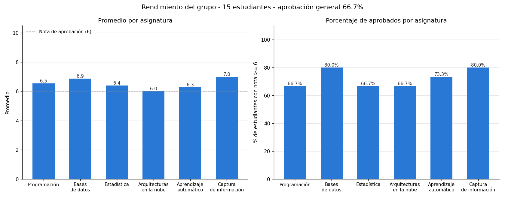

# Trabajo Integrador – Evaluación Estudiantil

**Materia:** Programación y Base de Datos – Especialización en Inteligencia Artificial (UNAJ)
**Repositorio:** https://github.com/especializacion-ia-unaj/programacion-y-base-de-datos (carpeta `tp-integrador`)

## 1. Objetivo

Sistema de gestión académica que lee las notas de los estudiantes en seis asignaturas desde un archivo CSV y:

- calcula el promedio de cada estudiante, con aplazos y sin aplazos;
- determina su situación académica (aprobado / reprobado);
- calcula estadísticas del grupo: promedio por asignatura, porcentaje de aprobación general y asignaturas con mayor y menor rendimiento;
- muestra los resultados por pantalla y genera un gráfico de barras.

## 2. Archivos

| Archivo | Contenido |
|---|---|
| `main.py` | Programa principal: coordina las cuatro etapas. |
| `configuracion.py` | Constantes: nota de aprobación, nota de aplazo, rango válido y lista de asignaturas. |
| `estudiante.py` | Clase `Estudiante`. |
| `curso.py` | Clase `Curso` (el grupo de estudiantes y sus estadísticas). |
| `lector_csv.py` | Lectura y validación del archivo CSV; crea los objetos `Estudiante`. |
| `reportes.py` | Reportes por pantalla y gráfico de barras. |
| `datos/estudiantes.csv` | Datos de ejemplo (15 estudiantes). |
| `grafico_rendimiento.png` | Gráfico generado con los datos de ejemplo. |
| `requirements.txt` | Librería externa necesaria (`matplotlib`). |

## 3. Diseño orientado a objetos

```
+-------------------------------------+        +------------------------------------------+
| Curso                               |        | Estudiante                               |
+-------------------------------------+ 1    * +------------------------------------------+
| - nombre: str                       |<>------| - nombre: str                            |
| - estudiantes: list[Estudiante]     |        | - apellido: str                          |
+-------------------------------------+        | - notas: dict {asignatura: nota}         |
| + agregar_estudiante(estudiante)    |        +------------------------------------------+
| + cantidad_estudiantes()            |        | + get_nombre_completo(), get_nota(...)   |
| + calcular_promedio_asignatura(a)   |        | + calcular_prom()                        |
| + calcular_porcentaje_aprobados_    |        | + calcular_prom_sin_aplazos()            |
|     asignatura(a)                   |        | + contar_aplazos()                       |
| + obtener_asignatura_mayor_         |        | + contar_asignaturas_aprobadas()         |
|     rendimiento() / menor_...       |        | + esta_aprobado()                        |
| + contar_aprobados()                |        | + obtener_sit()                          |
| + calcular_porcentaje_aprobacion()  |        +------------------------------------------+
| + calcular_promedio_general()       |
+-------------------------------------+
```

- **Estudiante** sigue el modelo del enunciado (`calcular_prom()` y `obtener_sit()`), con atributos privados y getters/setters. Cada estudiante sabe calcular su propio rendimiento.
- Las notas se guardan en un **diccionario** `{asignatura: nota}` en lugar de un atributo por materia (`nota_prog`, `nota_est`, ...). Así los cálculos se hacen con un solo `for` y agregar una asignatura no obliga a modificar la clase.
- **Curso** representa al grupo y se relaciona con `Estudiante` por **composición** ("un curso *tiene* estudiantes"). Las estadísticas del grupo están en `Curso` porque necesitan a todos los estudiantes, no a uno solo.
- La lectura del archivo (`lector_csv.py`) y la presentación (`reportes.py`) están en módulos separados de las clases. Las clases solo calculan; no leen archivos ni imprimen.

## 4. Decisiones de diseño

- **Criterios de evaluación** (en `configuracion.py`, fáciles de cambiar):
  - Aplazo: nota menor a 4.
  - Asignatura aprobada: nota mayor o igual a 6.
  - Estudiante aprobado: promedio con aplazos mayor o igual a 6.
  - Promedio sin aplazos: promedio de las notas mayores o iguales a 4. Si todas son aplazos, se muestra "-".
- **Rendimiento de una asignatura:** se mide por el promedio de sus notas. Si hay empate, se informa la primera en el orden de la lista.
- **Lectura del CSV con el módulo `csv`** (visto en la clase 6) en lugar de pandas. Cada fila se recorre con un `for` y se convierte en un objeto `Estudiante`, sin depender de una librería externa para esta parte.
- **Encabezados flexibles:** los nombres de las columnas se normalizan (minúsculas, sin tildes, sin espacios). Así se acepta el formato del ejemplo del enunciado (`programación`, `Arq_nube`, espacios después de las comas y coma final). Columnas adicionales se ignoran.
- **Validación de datos:** se usan excepciones (`try/except`):
  - archivo inexistente o sin las columnas necesarias: se informa el error y el programa termina sin fallar;
  - fila con una nota no numérica, fuera del rango 0–10 o con datos faltantes: se informa la línea y se omite esa fila, sin detener el análisis del resto.
- **Estilo de código:** Python imperativo con bucles `for`/`while` tradicionales (sin comprensiones de listas, `map`, `filter` ni `lambda`). Los máximos, mínimos y sumas se calculan recorriendo los datos.

## 5. Funcionamiento

Instalación y ejecución:

```
pip install -r requirements.txt
python main.py                                  # usa datos/estudiantes.csv
python main.py otro_archivo.csv                 # usa otro archivo
python main.py otro_archivo.csv --sin-ventana   # solo guarda el gráfico, sin abrir la ventana
```

Etapas que ejecuta `main.py`:

1. Lee el CSV y crea los objetos `Estudiante` (`lector_csv.leer_estudiantes`).
2. Agrega los estudiantes a un `Curso`.
3. Muestra el detalle de cada estudiante, las estadísticas por asignatura y el resumen del grupo.
4. Genera el gráfico de barras (`grafico_rendimiento.png`) y lo muestra en una ventana.

Formato esperado del CSV (el mismo del enunciado):

```
Nombre, apellido, programación, bases_d_datos, estadística, Arq_nube, Ap_automático, cap_información,
Ana,García,8,7,9, 6, 10, 4
```

## 6. Resultados con los datos de ejemplo

Resumen de la salida por pantalla:

```
Asignatura                    Promedio   % aprobados
----------------------------------------------------
Programación                      6.53         66.7%
Bases de datos                    6.87         80.0%
Estadística                       6.40         66.7%
Arquitecturas en la nube          6.00         66.7%
Aprendizaje automático            6.27         73.3%
Captura de información            7.00         80.0%
----------------------------------------------------
Asignatura con MAYOR rendimiento: Captura de información (promedio 7.00)
Asignatura con MENOR rendimiento: Arquitecturas en la nube (promedio 6.00)

Cantidad de estudiantes: 15
Aprobados: 10
Reprobados: 5
Porcentaje de aprobación general: 66.7%
Promedio general del grupo: 6.51
```

Gráfico generado:



